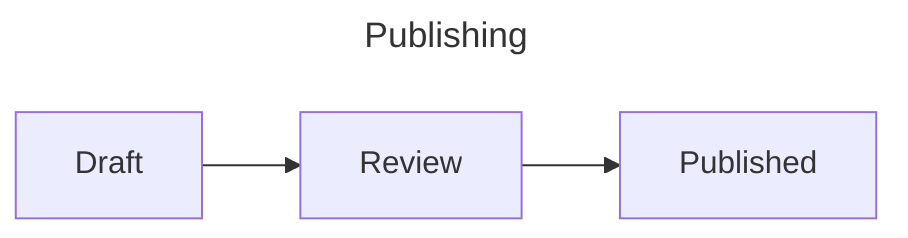
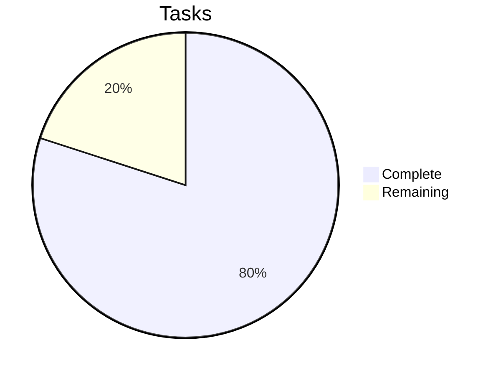

# Diagram examples

## Flowchart with frontmatter



## Sequence diagram

```{mermaid}
:name: request-flow
:caption: A **request** and response.
:alt: Client requests a page from the server.
:zoom: true
:width: 75%

sequenceDiagram
    Client->>Server: GET /docs
    Server-->>Client: HTML
```

## External file

```{mermaid} publishing.mmd
:caption: Loaded from a Mermaid document.
```

## Pie chart


