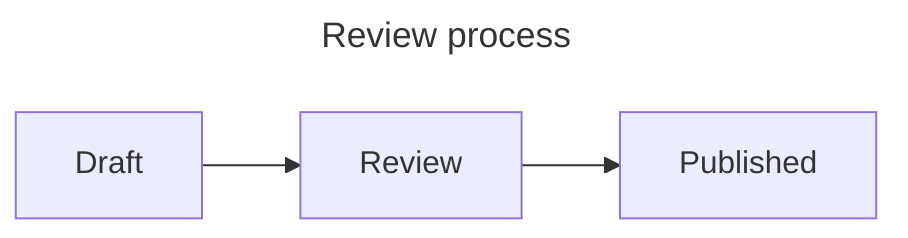

# How to style diagrams

## Set defaults for the site

Add defaults to `conf.py`:

```python
pele_options = {
    "fontSize": 18,
    "autoDirection": False,
    "zoom": "auto",
    "config": {"flowchart": {"nodeSpacing": 40}},
}
pele_css_variables = {
    "--pele-accent": "#205ea6",
    "--pele-font-mono": "ui-monospace, monospace",
}
```

Use `autoDirection: False` when a diagram's left-to-right direction must remain
fixed on narrow screens. Leave it unset to allow Pele to change direction when
space is limited.

## Override one diagram

Put `pele` inside the diagram's YAML frontmatter, within the Mermaid fence:

````markdown

````

Keep `config` for Mermaid settings and `pele` for renderer options. Do not put
this mapping in the Markdown page's frontmatter. See the
{ref}`precedence reference <diagram-configuration>` when an option
has more than one value.

In a directive, use `:options:` for the same renderer options:

```rst
.. mermaid::
   :options: {fontSize: 20, autoDirection: false}
   :zoom: {always: true, maxScale: 4, controls: true}
   :width: 80%
   :align: center

   flowchart LR
       Draft --> Review --> Published
```

## Match light and dark themes

For Furo and PyData themes, start with the extension's default stylesheet. It
reads the theme's color variables automatically.

For another theme, create `docs/_static/diagrams.css`. This example follows the
browser's preferred color scheme:

```css
.sphinx-pele {
  --pele-bg: #ffffff;
  --pele-fg: #1f2937;
  --pele-line: #374151;
  --pele-surface: #f3f4f6;
  --pele-surface-alt: #e5e7eb;
  --pele-border: #6b7280;
}

@media (prefers-color-scheme: dark) {
  .sphinx-pele {
    --pele-bg: #111827;
    --pele-fg: #f9fafb;
    --pele-line: #d1d5db;
    --pele-surface: #1f2937;
    --pele-surface-alt: #374151;
    --pele-border: #9ca3af;
  }
}
```

Register it in `conf.py`:

```python
html_static_path = ["_static"]
html_css_files = ["diagrams.css"]
```

If your theme has its own light/dark switch, replace the media query with that
theme's selector. Avoid setting the same variables in `pele_css_variables` or
diagram frontmatter when you want the stylesheet to control them: those settings
become inline styles on the container.

## Style one category of diagram

Give a directive a class:

```rst
.. mermaid::
   :class: review-diagram

   flowchart LR
       Draft --> Review
```

Then target it in your stylesheet:

```css
.sphinx-pele.review-diagram {
  --pele-surface: #fff3cd;
  --pele-fg: #332701;
  --pele-border: #856404;
}
```

To style individual nodes, use Mermaid `classDef` and `style` statements. Fixed
colors in those statements stay fixed when the page theme changes.
