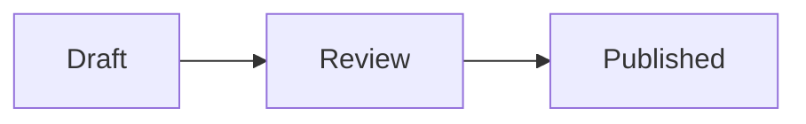
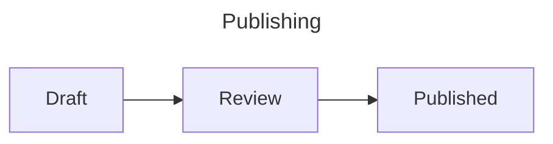

# How to add Mermaid diagrams

Install the development version with Python 3.11+, Git, Node.js 22+, and pnpm
11.11.0 available, then enable it in `conf.py`:

```sh
python -m pip install "sphinx-pele @ git+https://github.com/python-project-templates/sphinx-pele.git@main"
```

```python
extensions = ["sphinx_pele"]
```

Replace `sphinxcontrib.mermaid` if it is enabled. Both extensions register the
`mermaid` directive.

Add a diagram in reStructuredText:

```rst
.. mermaid::
   :caption: Publishing flow
   :name: publishing

   flowchart LR
       Draft --> Review --> Published
```

To load a Mermaid file, use a path relative to the current document:

```rst
.. mermaid:: diagrams/publishing.mmd
   :alt: Draft proceeds through review to publication.
```

For Markdown, install MyST and enable both extensions:

```sh
python -m pip install myst-parser
```

```python
extensions = ["myst_parser", "sphinx_pele"]
```

Use an ordinary `mermaid` fence or a MyST `{mermaid}` directive:

````markdown


```{mermaid}
:caption: Publishing flow
:zoom: true

flowchart LR
    Draft --> Review --> Published
```
````

Set defaults in `conf.py`:

```python
pele_options = {"fontSize": 16, "zoom": "auto", "config": {"flowchart": {"nodeSpacing": 30}}}
pele_css_variables = {"--pele-accent": "#205ea6"}
```

To customize one diagram, add Mermaid frontmatter:

````markdown

````

See [configuration](configuration.md) for supported options and precedence.

To refer to a captioned diagram in Markdown, give it `:name: publishing-flow`
and use a MyST reference role:

```markdown
See {ref}`publishing-flow`.
```

In reStructuredText, use:

```rst
See :ref:`publishing-flow`.
```

The [rendered reStructuredText examples](rst-examples.rst) show captions, links,
classes, and the `pele` alias together.

For theme colors and zoom recipes, see [how to style diagrams](styling.md).
