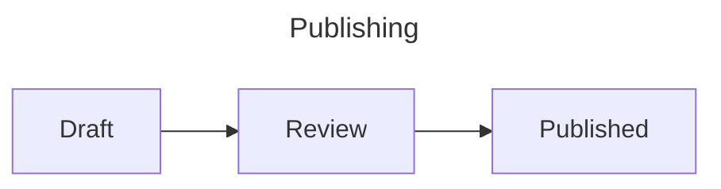

# How to add Mermaid diagrams

Install `sphinx-pele` and enable it in `conf.py`:

```sh
pip install sphinx-pele
```

```python
extensions = ["sphinx_pele"]
```

Replace `sphinxcontrib.mermaid` if it is enabled. Both extensions register the
`mermaid` directive.

Add a diagram in reStructuredText:

```rst
.. mermaid::
   :caption: Publishing flow
   :name: publishing

   flowchart LR
       Draft --> Review --> Published
```

To load a Mermaid file, use a path relative to the current document:

```rst
.. mermaid:: diagrams/publishing.mmd
   :alt: Draft proceeds through review to publication.
```

For Markdown, enable `myst_parser` alongside `sphinx_pele` and use an ordinary
`mermaid` fence or a MyST `{mermaid}` directive:

````markdown


```{mermaid}
:caption: Publishing flow
:zoom: true

flowchart LR
    Draft --> Review --> Published
```
````

Set defaults in `conf.py`:

```python
pele_options = {"fontSize": 16, "zoom": "auto", "config": {"flowchart": {"nodeSpacing": 30}}}
pele_css_variables = {"--pele-accent": "#205ea6"}
```

To customize one diagram, add Mermaid frontmatter:

````markdown

````

See [configuration](configuration.md) for supported options and precedence.
